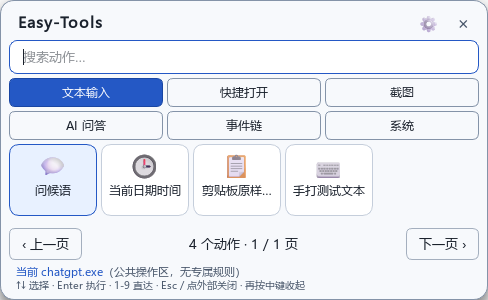
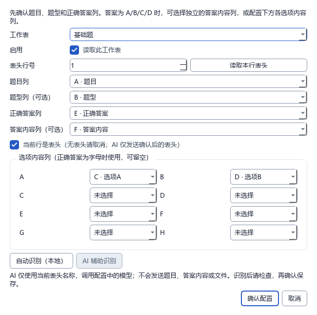
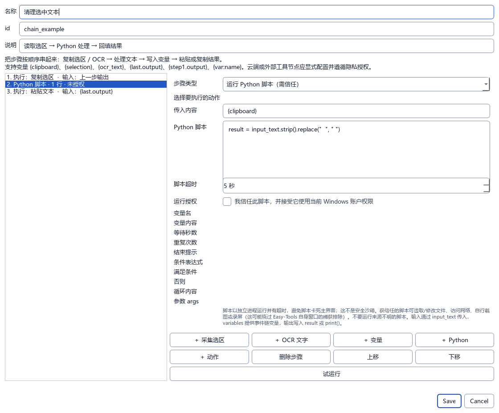
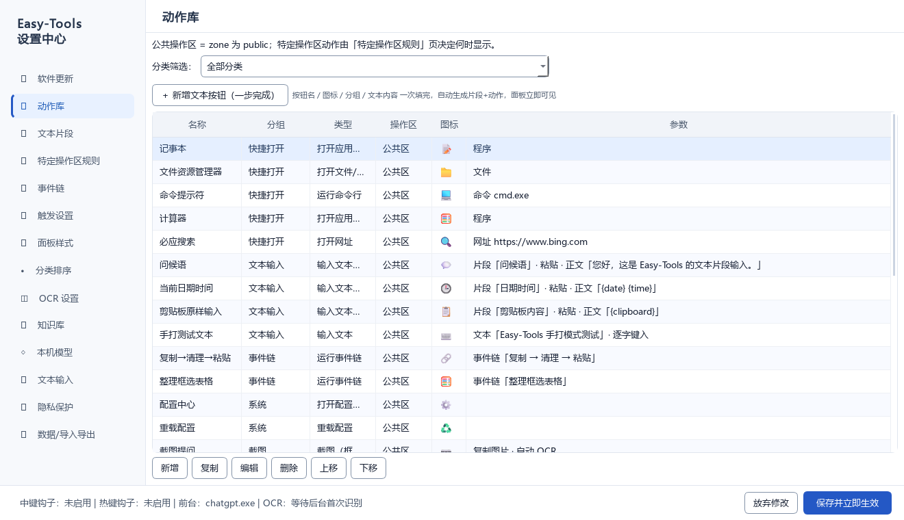

# Easy-Tools

**把常用操作放到鼠标旁边。** Easy-Tools 是一款 Windows 桌面效率工具：在任意应用中按下鼠标中键，就能呼出动作面板，搜索并执行文本输入、软件专属操作、截图提问和自动化流程。



## 亮点功能

### 中键呼出，常用动作一眼可达

- 按鼠标中键在光标旁打开面板；搜索动作，也可以用方向键、Enter 和数字键快速执行。
- 按类别切换 Tab，不用在长列表里反复滚动；类别顺序、每行格数和面板外观都可以在配置中心调整。
- 面板会根据前台软件显示对应操作。例如在 Word/WPS、Excel/WPS 表格或浏览器中，可把该软件专属的动作放在公共动作之前。

### 文本片段和拟人输入

- 保存常用文字、问候语、日期时间和剪贴板内容，点一下就能输入到当前窗口。
- 可选择粘贴或逐字手打；逐字输入支持换行和中英文、数字混排，按 **Esc** 可中断。
- 可为不同软件设置不同的文本动作，编辑时能直接查看完整文本内容。

### 截图、OCR 和知识库问答

- 框选屏幕内容后进行 OCR，再把识别结果用于提问或知识库检索。
- 知识库支持 Excel（`.xlsx`、`.xlsm`），可同时启用最多 3 个文件；可配置题目、题型、正确答案、答案内容和选项列。
- 选择“仅显示答案内容”时，可按正确答案对应的内容作答，适合选项顺序会变化的试卷。
- 内置轻量模型用于从已启用知识库中检索并返回答案，适合单轮、基于题库内容的问答；它不是通用聊天模型。
- 可从 CC Switch 导入模型配置，按需使用本机模型或云端模型。调用云端服务时，发送的问题、OCR 内容或检索片段会离开本机，请根据所选服务和数据内容决定是否使用。



### 事件链和 Python 脚本

把多个动作按顺序连接起来，例如“读取选中文本 → 清理内容 → 回填原窗口”。事件链支持文本处理、OCR、变量、条件、循环、等待和结果输出，也可以添加 Python 节点。

Python 节点需要单独授权，并在独立进程中运行，避免脚本卡住时拖住主界面。它**不是安全沙箱**：获授权的脚本拥有当前 Windows 账户权限，可以读写文件、访问网络或自行截屏，也可能绕过 Easy-Tools 的窗口捕获排除。只运行你信任的脚本。



### 隐私保护

开启隐私模式后，Easy-Tools 的面板、配置中心和结果窗口会请求 Windows 支持的窗口捕获接口将自身排除在截图和录屏之外。Easy-Tools 自己发起的截图与 OCR 仍可处理目标应用内容，不会为了识别而临时取消对自身窗口的排除。

此功能取决于 Windows 版本及截图/录屏软件使用的捕获接口，不能防止直接读取进程数据、辅助功能接口或外部摄像设备拍摄。云端模型和 Python 脚本也按上面的说明处理数据。

## 安装和启动

### Windows 安装包

运行 `Easy-Tools-Setup-<版本号>.exe`，按提示选择安装目录。安装器会检查常规旧版本目录，默认覆盖升级并保留用户配置；桌面和开始菜单快捷方式可自行勾选。

安装完成后启动 Easy-Tools。程序会常驻系统托盘，按鼠标中键即可打开动作面板；也可从托盘菜单打开配置中心、重载配置或退出程序。

### 从源码运行

在 Windows 上安装 Python 依赖，然后启动：

```powershell
python -m pip install -r requirements.txt
python main.py
```

OCR 后端是可选依赖；若不可用，配置中心会显示实际状态。模型配置和知识库保存在本机用户数据目录中。

## 使用建议

1. 打开配置中心的“动作库”，添加或编辑动作；在“文本输入”中维护可复用的文本片段。
2. 在“特定操作区规则”中选择目标进程、窗口标题或 OCR 关键词，并指定要显示的动作。
3. 在“知识库”中导入 Excel 文件，检查答案列和选项映射后启用；最多同时启用 3 个知识库。
4. 在“事件链”中编排重复操作；首次运行 Python 脚本前，先检查脚本内容和授权提示。

设置保存后立即生效。面板可按 **Esc** 或点击外部关闭，也可再次按中键收起。

## 本地打包

Windows 开发者可运行 `build.py` 和 `build_installer.py` 构建目录程序及单文件安装器。打包需要 PyInstaller、项目依赖、.NET Framework C# 编译器，以及模型文件 `models/SmolLM2-360M-Instruct-Q4_K_M.gguf`。模型权重约 270 MB，未存入 Git；下载来源和许可信息见 [`models/MODEL-NOTICE.txt`](models/MODEL-NOTICE.txt)。

项目代码约定、打包检查、GitHub Releases 和 DownloadCenter 灰度发布步骤见 [开发与发布规范](docs/开发与发布规范.md)。

## 项目截图

配置中心的动作库可以筛选分类、查看动作参数，并新增、编辑、复制、删除和调整动作顺序。



## 联系作者

- 作者：clb \<[lamthebest@foxmail.com](mailto:lamthebest@foxmail.com)\>
- 问题反馈 / 功能建议：[Issues](https://github.com/FortC/Easy-Tools/issues)

## 许可

项目许可见 [`LICENSE`](LICENSE)。内置模型及 llama.cpp 运行时另遵循各自的许可，详见 `models/` 和 `vendor/llama/` 中的许可文件；界面图标来自 [Lucide](https://github.com/lucide-icons/lucide)（ISC 许可，免费可商用），详见 `easy_tools/ui/icons/README.md`。
